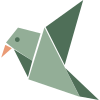

# Design

How Homing's screens look and behave. People work with Homing through their assistant, and open its pages to sign in, to decide something and, later, to browse and edit. Every screen follows this page.

## Principles

- Every element says something. If it doesn't, it goes.
- One job per page, with one obvious main action.
- Never more than needed, always enough to finish.
- A decision shows the exact change word for word, set apart from the rest, with who wants it and where it applies.
- Everyday words: "Claude wants to use Homing as you", never OAuth, scope or client.
- Anything that shares or removes says what will happen before you confirm.
- It works on a phone, with a keyboard and with a screen reader, to WCAG 2.2 AA.
- Quietly polished. The interface does the work, and illustrations give it character.

## Tagline

> **A home for everything worth knowing.**
> Homing brings together what you and your AI assistants learn, keeps it useful as life and work evolve, and lets you share it with the people who matter.

The headline never mentions AI, so the sentence under it goes with it wherever someone meets Homing for the first time.

## Logo

The mark is the folded paper bird: flat facets in two sages, with a peach beak. It's the pencil bird simplified so it holds up at 16 px and in a browser tab. The vector is [`docs/design/logo.svg`](design/logo.svg).

- Next to the name it sits at 1.4 times the text height, with "Homing" in Figtree semibold. That pair signs every page.
- The mark alone is for places where the name is already clear, such as the browser tab.
- On dark surfaces its facets lighten, through the `mark-light` and `mark-dark` tokens. Otherwise it is never recolored, stretched, outlined or rotated.
- The pencil bird is the mascot for drawings, and the mark is the signature. One doesn't replace the other.

## Look

Linen backgrounds, sage for actions and peach for what's only yours. Light only for now; dark mode comes later through the same tokens.

| Token | Value | Used for |
|---|---|---|
| `background` | `#F6F3EE` | The page, linen |
| `card` | `#FFFDF9` | Cards, fields and outline buttons |
| `foreground` | `#2B2824` | Text |
| `muted-foreground` | `#716A61` | Secondary text |
| `border` | `#E7E0D5` | Dividers and card edges |
| `input` | `#9B9083` | Field and checkbox edges, 3:1 against the card |
| `primary` | `#4F6F58` | Sage, the main action, with white text |
| `private` | `#F8E3D8` on `#864530` | "Only you" |
| `change` | `#EEF3EC` | The exact change being decided |
| `wash` | `#E9A98F` | Peach, for small accents |

Figtree is the only typeface, and it ships with the app. Page titles are 24 px, the exact change 18 px, body text 15 px, secondary text 13 to 14 px and labels 12 px. Corners start at 14 px, and buttons and fields are pills.

## Components

[shadcn/ui](https://ui.shadcn.com) in its Maia style, on [Base UI](https://base-ui.com), lives in `web/src/components/ui` and takes its colors from the tokens in `web/src/styles.css`. Add one with `npx shadcn@latest add <name>` from the repository root. Homing's own components sit next to it: the wordmark, the proposed change, "Only you", where a rule applies, and the rules that already apply.

- One primary button per view, for the main action. Everything else is an outline button.
- Main buttons on pages are 44 px tall and fill the width on a phone, with the main action on top.
- "Only you" is always a label. Color supports it but never carries it alone.
- A settled decision keeps showing the change, greyed, so it's clear what happened.
- The change being decided is always shown in full, never cut short, because approving runs exactly what was shown. A short rule is set large; a longer one at reading size, keeping its line breaks.

## Layout

- The mark and name sit top left, the person's name top right.
- Sign-in asks for the email first, then the passkey or password, and the email field offers saved passkeys directly. On a desktop the form is on the left and the illustration on the right, with the tagline; on a phone only the form shows, starting near the top.
- Sign-in with Google or Microsoft uses the providers' own marks, as their guidelines ask.
- Decision pages are one centered column with a single heading that says who wants what, where.

## Illustrations

Every drawing says something about Homing, with the same few objects:

| Concept | Drawn as |
|---|---|
| An assistant | The paper bird, Homing's mascot. It carries what it learned to where it belongs |
| A space | A box on a shelf |
| Knowledge | Index cards |
| Only yours | A closed notebook |
| Rules | A note pinned to the wall |
| Kept current | An old date crossed out, with a new card beside it |

Drawings are scenes with people, in colored pencil, in sage, peach and warm grey, light and airy. They appear only on welcome, onboarding, success and empty pages, never on approvals or routine screens. They're drawn on pure white and shipped with a transparent background, so they sit on any surface without a box. No robots, brains, bees, hexagons or screens.

The bird always looks like its character sheet, [`docs/design/paper-bird.jpg`](design/paper-bird.jpg): sage wings, a peach beak and belly, a small dark eye, the same folds. Every drawing with the bird is generated with the sheet as a reference, in this style:

> Soft colored-pencil drawing with gentle visible pencil texture, rounded friendly shapes, a muted pastel palette of sage green, soft peach and warm gray, light and airy. Plenty of empty space, nothing cropped. Pure flat white background. No text, no logos, no screens.

On the sign-in page the bird sits on the edge of the sign-in card.

## The approval card

Inside Claude and ChatGPT the approval card takes the host's colors, font and corners, and keeps sage for the main action. In a dark host the sage turns lighter and more saturated, so the main action never looks disabled. It uses the same components as the confirmation page and is built as one self-contained HTML file.

## Working on screens

`npm run dev:web` serves every screen with sample data, and its start page lists them, each state at its own address.
